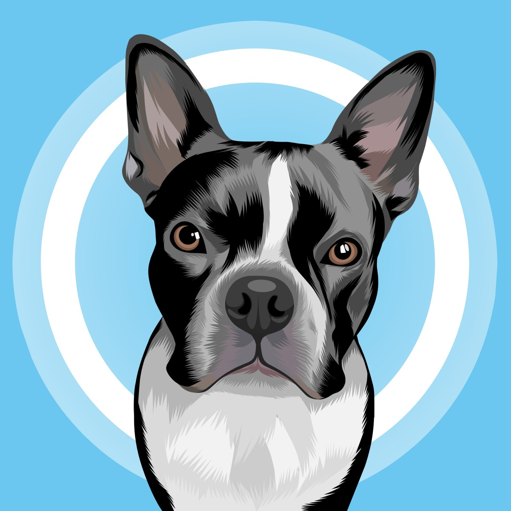
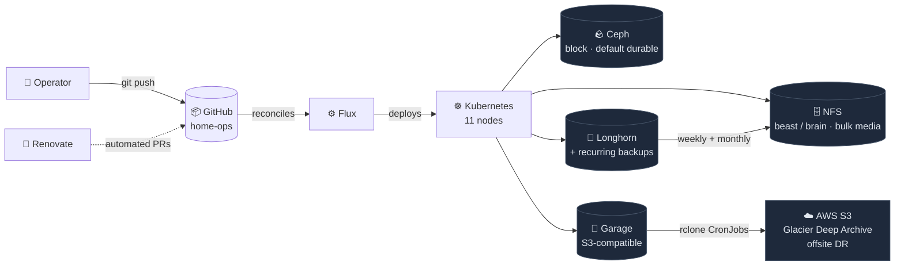
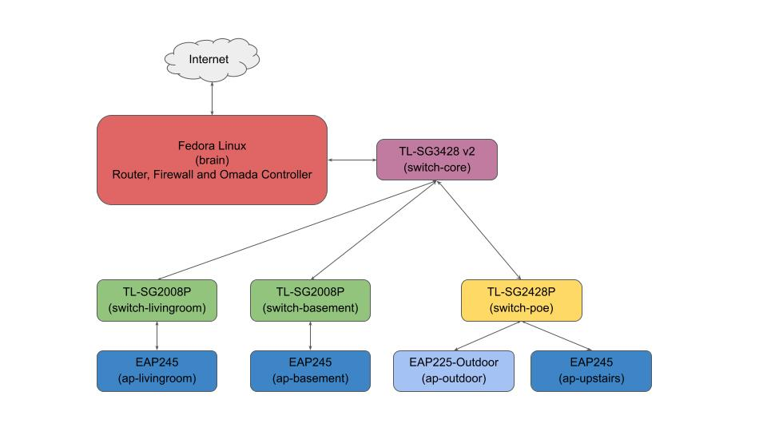
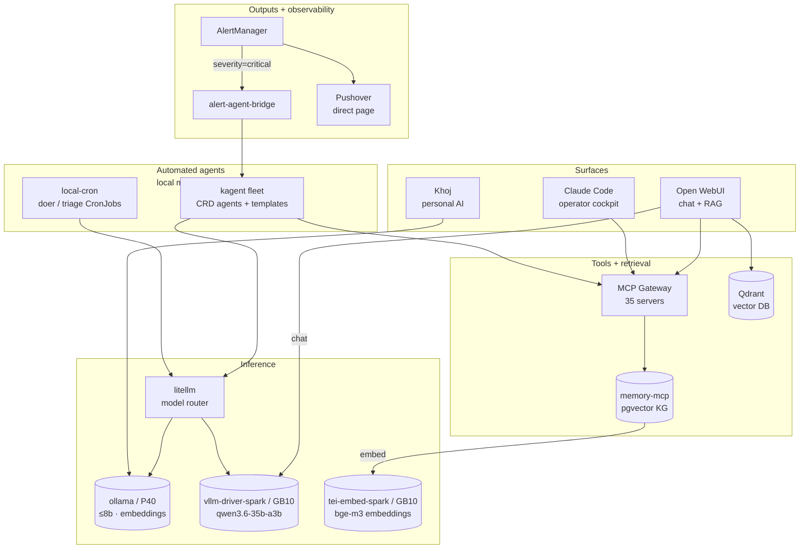

# Lovenet Home Operations Repository

_Production-grade Kubernetes for a household._
**GitOps** with Flux · **Automated dependency updates** with Renovate · **Self-hosted by design**

 

 

---

## 📖 Overview

This is the live configuration for a multi-node Kubernetes cluster that runs a household — home automation, security cameras, media, document management, AI workloads, and the operational tooling required to keep it all up. Every change lands in Git first; Flux reconciles the cluster from there, and Renovate keeps dependencies current via PRs.

The repo is GitOps-strict: applications are declared as `HelmRelease` resources, secrets are pulled from 1Password through External Secrets Operator, and clusters are mostly identical except for app selection and sizing. Operational quirks, durability tiers, and security defaults live alongside the manifests in [`.agents/instructions/`](https://github.com/rwlove/home-ops/tree/main/.agents/instructions) so the conventions are enforceable, not folklore.

---

## 🗺️ Architecture

Storage tiers are picked deliberately per workload — see [`storage-class.instructions.md`](https://github.com/rwlove/home-ops/blob/main/.agents/instructions/storage-class.instructions.md) for the decision tree.

---

## 🧰 Stack at a glance

| Layer            | Tool                                | Role                                                  |
|------------------|-------------------------------------|-------------------------------------------------------|
| **OS**           | CentOS Stream 9 / 10 (+ Ubuntu 24.04 on Spark) | Node operating system                      |
| **Runtime**      | cri-o + crun (containerd on Spark)  | CRI + OCI runtime; Spark is the lone containerd node  |
| **Kubernetes**   | v1.36.4                             | Control-plane and node version                        |
| **GPU**          | NVIDIA GPU Operator + Container Toolkit | P40 on worker8 (Pascal, 24 GB); GB10 on Spark (Grace-Blackwell, 128 GB unified) |
| **GitOps**       | Flux2                               | Declarative cluster reconciliation                    |
| **Automation**   | Renovate + GitHub Actions           | Dependency PRs, link checks, self-hosted runners     |
| **CNI**          | Cilium (eBPF)                       | Networking, BGP peering, LoadBalancer pool            |
| **Ingress**      | Envoy Gateway                       | L7 gateway / HTTPRoute                                |
| **Service mesh** | Istio                               | mTLS + traffic mgmt for mcp-system                    |
| **Admission**    | Kyverno                             | Namespace-delete blast-radius + audit-mode policies   |
| **DNS**          | external-dns                        | Cloudflare + bind9 split-horizon                      |
| **TLS**          | cert-manager                        | Let's Encrypt + internal CA                           |
| **Tunnel**       | cloudflared                         | Public ingress without exposing home WAN              |
| **AuthN/Z**      | Authelia + Envoy extAuth            | SSO; per-route `SecurityPolicy` ext-authz gates apps  |
| **Secrets**      | External Secrets Operator + 1Password | Zero plain-text in Git                               |
| **VPN**          | wg-easy                             | Operator OOB WireGuard access                         |
| **Storage**      | Rook-Ceph, Longhorn, Garage, direct NFS | Tiered by durability requirement                  |
| **Databases**    | CloudNative-PG, Dragonfly, Qdrant   | Postgres clusters, KV store, vector search            |
| **Observability**| kube-prometheus-stack, Loki, Tempo, Grafana | Metrics, logs, traces, dashboards                    |
| **Telemetry**    | OpenTelemetry Collector + Vector    | Trace pipeline (→ Tempo) + log shipping (→ Loki)      |
| **Images**       | ZOT                                 | Pull-through registry / local cache                   |

---

## 🖥️ Hardware

| Role | Hostname  | Device              | CPU | RAM   | OS         | Storage / Accelerators       | Notes                                 |
|------|-----------|---------------------|-----|-------|------------|------------------------------|---------------------------------------|
| 🧠   | master1   | bare-metal          | 4   | 32 GB | CentOS 10  | NVMe (Longhorn)              | Intel iGPU · RTL-SDR · control plane  |
| 🧠   | master2   | VM on **beast**     | 3   | 10.5 GB | CentOS 10  |                              | virtualized control plane             |
| 🧠   | master3   | VM on **beast**     | 3   | 10.5 GB | CentOS 10  |                              | virtualized control plane             |
| 💪   | worker2   | ThinkCentre M910x   | 8   | 32 GB | CentOS 9   | NVMe (Longhorn + Ceph OSD)   | ZWA-2 Z-Wave dongle                   |
| 💪   | worker3   | ThinkCentre M910x   | 8   | 64 GB | CentOS 9   | NVMe (Longhorn + Ceph OSD)   | Sonoff Zigbee dongle                  |
| 💪   | worker4   | ThinkCentre M910x   | 8   | 32 GB | CentOS 9   | NVMe (Longhorn + Ceph OSD)   | Coral USB TPU                         |
| 💪   | worker5   | VM on **beast**     | 10  | 21.5 GB | CentOS 10  | NVMe (Longhorn + Ceph OSD)   |                                       |
| 💪   | worker6   | VM on **beast**     | 10  | 26.5 GB | CentOS 10  | NVMe (Longhorn + Ceph OSD)   |                                       |
| 💪   | worker7   | VM on **beast**     | 10  | 26.5 GB | CentOS 10  | NVMe (Longhorn + Ceph OSD)   |                                       |
| 🎮   | worker8   | VM on **beast**     | 10  | 51.5 GB | CentOS 10  | NVMe (Longhorn + Ceph OSD)   | NVIDIA **P40** (24 GB VRAM)           |
| 🚀   | spark     | NVIDIA DGX Spark    | 20  | 128 GB| Ubuntu 24.04 | NVMe + 8 GPU slots         | NVIDIA **GB10** (Grace-Blackwell, 128 GB unified); arm64 · containerd outlier |

### Off-cluster infrastructure

| Host    | Role                                                                                          |
|---------|-----------------------------------------------------------------------------------------------|
| `beast` | Dell R730xd · iDRAC 8 · RAID6 bulk storage · primary NFS · Longhorn backup target · Garage substrate · VM host |
| `brain` | Router/gateway · RAID6 mass_storage · NFS for downloads & TV · OOB SSH on `:3231`              |

---

## 🌐 Network

<b>Physical topology</b> (click to expand)

 

| Network                                        | CIDR                  | VLAN |
|------------------------------------------------|-----------------------|------|
| Default                                        | `192.168.0.0/16`      | 0    |
| IoT                                            | `10.10.20.0/24`       | 20   |
| Guest                                          | `10.10.30.0/24`       | 30   |
| Security (cameras)                             | `10.10.40.0/24`       | 40   |
| Kubernetes pod subnet (Cilium)                 | `10.42.0.0/16`        | —    |
| Kubernetes services subnet (Cilium)            | `10.43.0.0/16`        | —    |
| Kubernetes LB pool (CiliumLoadBalancerIPPool)  | `10.45.0.0/24`        | —    |

Worker nodes attach to **iot** and **sec** VLANs via Multus for direct camera and IoT-device reachability. Cilium peers BGP with the upstream router to advertise the LB pool; external ingress flows through Envoy Gateway behind cloudflared.

---

## 📦 What's running

🏠 <b>Home Automation</b> — Home Assistant ecosystem, 400+ devices

| App | Purpose |
|-----|---------|
| **Home Assistant** | Primary orchestrator; 400+ Z-Wave / Zigbee / Matter / ESPHome devices |
| **ESPHome** | Build & deploy firmware for DIY sensors |
| **EMQX** | MQTT broker |
| **Node-RED** | Visual automation flows |
| **Zigbee2MQTT** | Zigbee bridge (Sonoff stick on worker3) |
| **Z-Wave JS UI** | Z-Wave bridge (ZWA-2 stick on worker2) |
| **Matter Server** | Matter protocol bridge |
| **Frigate** | NVR + ML camera analysis (7+ cameras, Frigate+ trained model) |
| **NetBox** | IPAM / DCIM |
| **wyoming-services** | Piper TTS + Whisper STT for voice |
| **smtp-relay** | Maddy → Mailgun outbound mail |

🎬 <b>Media & Entertainment</b> — Jellyfin, Immich, Music Assistant, RomM

| App | Purpose |
|-----|---------|
| **Jellyfin** | Primary media server (read-only metadata) |
| **Immich** + **immich-pet-tagger** + **immichkiosk** + **immich-power-tools** | Photo library with ML face/pet recognition, offsite-backed |
| **Music Assistant** + **Gonic** | Multi-room music control + Subsonic API |
| **RomM** | Retro game library (~10k ROMs) |
| **Beets** | Music library tagging |
| **av1corrector / videodupfinder / medialyze** | Custom video tooling |
| **Theme Park** | Consistent UI theming across apps |
| **Batocera Webdashboard Pro** | Retro-gaming console dashboard |
| **kodi-playback-watcher** | Bridge for Kodi playback state |

🤖 <b>AI & ML</b> — Local inference, agents, image generation (namespace <code>ai/</code>)

| App | Purpose |
|-----|---------|
| **kagent** | CNCF Kubernetes-native agent runtime — CRD-defined operator + concierge agent fleet on local models |
| **local-cron** | Scheduled doer / triage / digest CronJobs on local models |
| **litellm** | Model router fronting the local GPUs for the agent fleet |
| **alert-agent-bridge** | Fans critical alerts to the kagent observability-operator for enrichment |
| **Ollama** (P40) | Local LLM serving on the Pascal P40 (≤8b-class models, embeddings) |
| **vLLM (Spark)** | LLM serving on Spark/GB10 — `vllm-driver-spark` (qwen3.6-35b-a3b) for Open WebUI chat; plus parked coder / decompile drivers |
| **ComfyUI** | Image generation workflows (ComfyUI + comfyui-spark on GB10) |
| **Khoj** | Personal AI assistant over notes + docs (Authelia extAuth-gated) |
| **LightRAG** | Graph-RAG retrieval (general + finance) over the document corpus |
| **Paperless-AI** | Auto-tagging for paperless-ngx |
| **tei-embed-spark** | Text-embedding-inference (bge-m3) on Spark/GB10 — RAG + knowledge-graph embeddings |
| **tei-spark** | Text-embedding-inference reranker (unsuspended 2026-05-21) |

📊 <b>Observability</b> — Prom/Loki/Grafana

| App | Purpose |
|-----|---------|
| **kube-prometheus-stack** | Prometheus + AlertManager + node-exporter |
| **Loki** | Log aggregation |
| **Tempo** | Distributed tracing backend (SingleBinary mode) |
| **OpenTelemetry Collector** | Trace ingestion pipeline (apps → OTel → Tempo) |
| **Vector** | Log shipping (sources → Loki) |
| **Grafana** | Dashboards + alerting UI |
| **kube-state-metrics / kube-ops-view** | Cluster state & visualization |
| **Goldilocks** | VPA-driven resource right-sizing recommendations |
| **Kromgo** | Prometheus → Glance dashboard bridge |
| **Netdata** | Per-node real-time metrics |
| **network-ups-tools (NUT)** | UPS monitoring & graceful shutdown |
| **exporters** | Custom Prometheus exporters |

🗄️ <b>Data & Storage</b> — Databases, object storage, vector search

| App | Purpose |
|-----|---------|
| **CloudNative-PG** | Postgres clusters with WAL archiving to Garage |
| **Dragonfly** | Redis-compatible in-memory store |
| **Qdrant** | Vector DB for embeddings / RAG |
| **pgAdmin** | Postgres admin UI |
| **Rook-Ceph** | Distributed block storage (default durable tier) |
| **Longhorn** | Block storage with NFS-backed recurring backups |
| **Garage** | S3-compatible object storage (DB backups, app S3 workloads) |

🌐 <b>Network, Auth & Platform</b> — Ingress, SSO, GitOps machinery

| App | Purpose |
|-----|---------|
| **Cilium** | CNI, BGP, LoadBalancer pool |
| **Envoy Gateway** | Ingress / HTTPRoute (30 routes) |
| **cert-manager** | TLS certificate lifecycle |
| **external-dns** | Cloudflare + bind9 record sync |
| **cloudflared** | Public tunnel without exposed WAN |
| **Authelia** | OIDC identity provider |
| **LLDAP** | Lightweight LDAP directory backing Authelia |
| **extAuth SecurityPolicies** | per-route Authelia ext-authz gating app SSO |
| **wg-easy** | Primary OOB WireGuard access |
| **External Secrets Operator** | 1Password-backed secret materialization |
| **Flux2** | GitOps reconciler |
| **Renovate** | Image & Helm chart update PRs |
| **Kuadrant** | MCP server gateway (Authelia-gated JWT) |
| **Kyverno** | Admission controller — namespace-delete blast-radius + audit-mode policies |
| **actions-runner-controller** | Self-hosted GitHub Actions runners |
| **ZOT** | Pull-through registry cache |

🗂️ <b>Documents & Collaboration</b> — Personal knowledge stack + self-hosted tools

| App | Purpose |
|-----|---------|
| **Paperless-ngx** | Document scanning, OCR, tagging (CNPG-backed, offsite-backed) |
| **Obsidian** + **obsidian-couchdb** | Notes sync (CouchDB w/ Cloudflare rate-limiting) |
| **Zulip** | Self-hosted team chat |
| **Windmill** | Workflow automation; 7 checked-in TypeScript flows under `kubernetes/apps/home/windmill/workflows/` cover the unified paperless→Qdrant+LightRAG fan-out ingest, paperless + LightRAG RAG tombstones, Windmill self-failure-watch, and the workaround upstream-watcher. (The two original split ingests — `paperless-rag-ingest` (Qdrant) + `lightrag-rag-ingest` (graph) — were merged into `paperless-rag-fanout` on 2026-07-20; their `.ts` remain and their schedules are paused for rollback. Down from 23 — the 16 langgraph-agents-fleet-specific flows, including the inbox/approval/digest/DLQ/cost-cap/awaiting-user/reviewer-weekly scripts and the Zulip triager webhook, were removed 2026-07-06 along with the fleet.) |
| **ntfy** | Self-hosted push notifications (operator approvals via Android tap actions) |
| **BentoPDF** | Self-hosted PDF toolkit |
| **Kitchenowl** | Shopping lists + recipe / meal management |
| **Open WebUI** | Self-hosted LLM frontend; routes chat to vllm-driver-spark (default) / Ollama-P40, and pulls in the MCP gateway as its only tool server (the langgraph-agent-as-model registration and the HolmesGPT tool server were both removed 2026-07-06). RAG via bge-m3 + bge-reranker-v2-m3 over Qdrant |
| **SearXNG** | Privacy-respecting metasearch engine |
| **Glance** | Personal dashboard / start page |
| **Atuin** | Encrypted shell-history sync across machines |
| **IT-Tools** | Self-hosted developer toolbox |
| **MediKeep** | Personal medical records |
| **Nametag** | Name tag / badge generator |
| **Pump** + **Pump-cv** | Custom personal apps (`rwlove`-built) |

🔌 <b>MCP Servers</b> — 35 Model Context Protocol servers behind an Authelia-gated gateway

| Server | Exposes |
|--------|---------|
| **mcp-gateway** | Aggregating gateway; Envoy SecurityPolicy validates Authelia-issued JWTs (daily-rotated key) |
| **ha-mcp** | Home Assistant entities + service calls |
| **esphome-mcp** | ESPHome dashboard: device YAML edit, validate, logs, compile + OTA flash |
| **kubectl-mcp** | Cluster introspection + safe `kubectl` ops |
| **grafana-mcp** | Grafana dashboards + Loki/Prom queries |
| **prometheus-mcp** | Direct PromQL access |
| **paperless-mcp** | Paperless-ngx document search |
| **netbox-mcp** | NetBox IPAM / DCIM |
| **github-mcp** | GitHub repo + PR ops |
| **omada-mcp** | TP-Link Omada controller |
| **searxng-mcp** | Privacy search through SearXNG |
| **arr-mcp** | Library-search interface to media-pull apps |
| **time-mcp** | Time / timezone utilities (`rwlove/time-mcp` native-SHTTP build) |
| **chrome-mcp** | Playwright-driven Chromium browser automation for agents |
| **memory-mcp** | Cross-agent knowledge graph backed by Postgres + pgvector (bge-m3 1024-dim) |
| **cilium-mcp** | Read-only Cilium / Hubble introspection (kubectl-mcp-style, Cilium-scoped) |
| **windmill-mcp** | Aggregated Windmill workspace tools (script run, flow trigger) |
| **ghidra-mcp** | Headless Ghidra + GhidraMCP 2.0 reverse-engineering tools |
| **notify-mcp** | Outbound notification fan-out (email) for agents + crons |

The balance of the 35 registered servers are **per-domain concierge
backends** (health, vehicles, food, wardrobe, finance, property,
insurance, music, …) that back the kagent persona fleet — same
Authelia-gated gateway, omitted here for brevity.

---

## 🧠 AI architecture (overview)

Local-first by default. Two automated surfaces run on local GPUs and
cost zero Claude tokens: the **kagent** fleet (CNCF Kubernetes-native
agent runtime — agents, models, and tools are CRDs, served by local
models through `litellm`) and the **local-cron** persona doer/triage
CronJobs. Both reach their tools through the Authelia-gated MCP
gateway. **Claude Code** (this CLI) is the interactive operator
cockpit on top. There is still no _automated_ lane to the Claude API —
escalation to Claude is operator-driven only.

The predecessor `langgraph-agents` fleet was retired 2026-07-06 and
**replaced by kagent**; HolmesGPT and Langfuse were removed in the same
cleanup (alert enrichment now runs through the kagent
observability-operator — see **Alert triage** below).

> 📖 **Full chapter**: see [`docs/src/ai_architecture.md`](https://github.com/rwlove/home-ops/blob/main/docs/src/ai_architecture.md)
> and [`docs/src/kagent_mcp_gateway_migration.md`](https://github.com/rwlove/home-ops/blob/main/docs/src/kagent_mcp_gateway_migration.md)
> for per-app integration paths, RAG pipelines, the kagent fleet, and the
> historical agent-fleet roster.

The langgraph-agents plumbing (the old fleet, its gated Claude API
lane, and its OTLP trace producer) was removed 2026-07-06; the kagent
fleet above replaced it, running entirely on local models.

### Surfaces and bridges

- **Open WebUI** (`collab/`) — primary chat UI. Defaults to qwen3.6-35b-a3b on vllm-driver-spark (GB10). RAG runs over Qdrant with bge-m3 embeds (tei-embed-spark) + BGE reranker-v2-m3 in-process. Tool server wired in: the MCP gateway (the langgraph-agent-as-model registration and the HolmesGPT tool server are both gone).
- **Khoj** (`ai/`) — parallel personal-AI surface for notes + docs. Self-contained: own embedding pipeline (default gte-small, optionally ollama nomic-embed-text), chat via Ollama-P40. Does **not** consume the MCP gateway.
- **HolmesGPT** — removed 2026-07-06 (no value delivered). The `windmill-investigate` route/receiver and the `alertmanager-holmesgpt-notify.ts` bridge were removed in Stage 1 (critical alerts now go straight to Pushover); the HolmesGPT deployment itself, its RBAC, its Open WebUI tool-server registration, and its Ollama/Authelia wiring were removed in Stage 2. HolmesGPT no longer exists anywhere in the cluster.
- **langgraph-agents** — removed 2026-07-06. The FastAPI multi-agent runtime, its Postgres checkpoints (`postgres-langgraph-checkpoints`, deleted), vault PVCs (`langgraph-vault`/`langgraph-vault-rw`, deleted), and both public routes (`hai.${SECRET_DOMAIN}` and `hai-web.${SECRET_DOMAIN}`) are gone. `sync-receiver` — an sshd sidecar that existed solely to expose the langgraph-vault PVCs over rsync — was deleted alongside it. See [Agent fleet — status today](https://github.com/rwlove/home-ops/blob/main/docs/src/ai_architecture.md#agent-fleet--status-today) for the historical roster.
- **Windmill** (`home/`) — 7 checked-in TypeScript flows remain under `kubernetes/apps/home/windmill/workflows/` (down from 23): the unified `paperless-rag-fanout` ingest (Qdrant + LightRAG from one pull), Paperless + LightRAG RAG tombstones, Windmill self-failure-watch, and the workaround upstream-watcher. The two original split ingests (`paperless-rag-ingest`, `lightrag-rag-ingest`) were merged into the fan-out 2026-07-20 — retained on disk, schedules paused for rollback. The 16 langgraph-fleet-specific flows (inbox, approval post/receive, daily digest, cost-cap watcher, awaiting-user sweep, DLQ watcher, weekly operator-drift crons, the approval-flow smoke test, and the Zulip triager webhook) were deleted 2026-07-06.
- **Langfuse** — removed 2026-07-06. Its only consumer (langgraph-agents) was already gone; the keep-dormant-vs-remove question is now resolved as remove.
- **memory-mcp** (`mcp-system/`) — cross-agent knowledge graph on `postgres-langgraph-memory` with pgvector(1024), bge-m3 embeds via tei-embed-spark. Fully unaffected by the decommission — it's memory-mcp's own database, used by Claude Code and Open WebUI. It just lost langgraph-agents as a consumer.

### Agent fleet — kagent (current)

The automated agent fleet today is **kagent** (`ai/kagent`), a CNCF
Kubernetes-native agent runtime. Agents, model configs, and tool
bindings are CRDs reconciled by Flux; the fleet is a set of operator
and concierge personas (storage / network / observability / ml /
smart-home operators, a triage router, a home-ops operator, plus
per-domain concierge agents) backed by agent templates. Every agent
runs on **local models** via `litellm` (Ollama on the P40, vLLM on
Spark) and reaches its tools through the Authelia-gated MCP gateway —
so the fleet costs **zero Claude tokens**. It is also consumable
interactively from Claude Code over MCP.

The sibling **local-cron** app (`ai/local-cron`) runs the scheduled
doer/triage and digest CronJobs on the same local models.

> The predecessor `langgraph-agents` FastAPI fleet (`triager`,
> `supervisor`, `historian`, operator personas, and ~20 more agents)
> was removed in its entirety 2026-07-06 — its Postgres checkpoints,
> vault PVCs, both public routes, and `sync-receiver` sidecar are
> gone. kagent replaced it. The historical roster is preserved in
> [`docs/src/ai_architecture.md`](https://github.com/rwlove/home-ops/blob/main/docs/src/ai_architecture.md),
> and the gateway cutover in
> [`docs/src/kagent_mcp_gateway_migration.md`](https://github.com/rwlove/home-ops/blob/main/docs/src/kagent_mcp_gateway_migration.md).

### Local-first routing tiers

| Tier | Backend                              | When used                                                  |
|------|--------------------------------------|---------------------------------------------------------------|
| 1    | `qwen2.5:7b` on Ollama (P40)         | Fast / simple chat, embeddings, voice STT/TTS support      |
| 2    | `qwen3.6-35b-a3b` on vllm-driver-spark (GB10) | Default chat inference (Open WebUI) |

The kagent fleet and local-cron route to these same two tiers through
`litellm`. There is **no automated cloud-escalation tier** — the old
gated Claude API lane (`ENABLE_CLAUDE_API`, per-task/agent/day cost
caps) went away with langgraph-agents 2026-07-06 and was not rebuilt;
escalation to Claude is operator-driven (Claude Code) only.

### Voice-to-action: retired, known gap

Before 2026-07-06, holding the phone's power button and saying "inbox
&lt;whatever I'm thinking&gt;" routed through Whisper STT → an HA
`rest_command` → Windmill → `langgraph-agents` `/inbox`, which
triaged the note to a specialist agent and synced results to the
Obsidian vault. That backend is gone.

**Known gap, not yet fixed:** the HA voice `rest_command` (defined in
the separate `home-assistant-config` repo) still exists and still
POSTs toward the deleted Windmill webhook — it will silently fail.
The full original design (mermaid diagram + step-by-step path) is
preserved as a historical record in
[`docs/src/workflow_automation.md`](https://github.com/rwlove/home-ops/blob/main/docs/src/workflow_automation.md).

### Alert triage

AlertManager pages Pushover directly for every critical alert, and —
via a `continue: true` route — _also_ fans `severity: critical` alerts
to the **alert-agent-bridge** (`ai/alert-agent-bridge`), which hands
them to the kagent observability-operator for root-cause enrichment.
Enrichment is additive: the raw page still reaches Pushover exactly as
before, and the bridge logs-only on enrichment failure so it can never
swallow a page. (HolmesGPT filled this slot until 2026-07-06, when it
was removed — no value delivered — and later replaced by the kagent
bridge.)

### Current state

- **kagent fleet + local-cron** — the live automated agent surface, on
  local models (see **Agent fleet** above). Replaced langgraph-agents.
- **memory-mcp** — kept; cross-agent knowledge graph on
  `postgres-langgraph-memory` (pgvector 1024, bge-m3). Used by the
  kagent fleet, Claude Code, and Open WebUI.
- **HolmesGPT** — removed 2026-07-06; alert enrichment is now the
  kagent observability-operator via alert-agent-bridge.
- **LangGraph fleet** — removed 2026-07-06 in its entirety (FastAPI
  runtime, `postgres-langgraph-checkpoints`, the
  `langgraph-vault`/`langgraph-vault-rw` PVCs, both public routes, and
  `sync-receiver`; 16 of 23 Windmill workflows deleted with it).
  Replaced by kagent.
- **claude-runner** — retired; there is no _automated_ Claude Code or
  Claude API pipeline in the cluster. Claude Code is interactive-only
  (operator-driven, same as the session that made this edit); automated
  agent work runs on local models via kagent/local-cron.
- **KubeClaw** — retired (memo `project_open_issues_cleanup_2026_05_20`).

---

## ☁️ Cloud dependencies

| Service                                          | Use                                                              | Cost              |
|--------------------------------------------------|------------------------------------------------------------------|-------------------|
| [1Password](https://1password.com/)              | Secret backend for External Secrets                              | ~$65 / yr         |
| [Cloudflare](https://www.cloudflare.com/)        | Domain, DNS, tunnel, WAF rate-limiting                           | Free              |
| [GitHub](https://github.com/)                    | Repo hosting + CI                                                | Free              |
| [Mailgun](https://www.mailgun.com/)              | Outbound mail relay (via Maddy)                                  | Free (Flex)       |
| [Pushover](https://pushover.net/)                | Push notifications for AlertManager + apps                       | $10 one-time      |
| [Frigate+](https://plus.frigate.video/)          | Trained ML model for Frigate NVR                                 | $50 / yr          |
| [AWS S3 Glacier Deep Archive](https://aws.amazon.com/glacier/) | Offsite DR for Immich + Paperless (objects + DB backups) | ~$1–5 / mo (varies) |
|                                                  |                                                                  | **~$10–15 / mo**  |

---

## 🛡️ Operational pillars

### 💾 Tiered storage durability

Four tiers, picked by what the data has to survive — node loss, Ceph loss, cluster loss, or full site loss. Databases get `ceph-block` + Barman→Garage; irreplaceable state goes to Longhorn with NFS-shipped weekly + monthly backups; S3-shaped workloads use Garage; bulk media rides direct NFS. Full decision tree: [`.agents/instructions/storage-class.instructions.md`](https://github.com/rwlove/home-ops/blob/main/.agents/instructions/storage-class.instructions.md).

### 🔐 Secrets — zero plain-text in Git

All ExternalSecrets resolve through External Secrets Operator from 1Password. Application credentials are templated into `ExternalSecret` resources and never live in YAML. Cross-namespace mirrors use the reflector pattern when consumer charts hard-code secret names.

### 🪪 Authentication — single sign-on everywhere

Authelia (with LLDAP) is the identity provider; per-route Envoy Gateway `SecurityPolicy` extAuth (Authelia's ext-authz endpoint) enforces auth at the gateway — ~39 per-route `SecurityPolicy` gates today, tiered admin vs household via `access_control` rules (the oauth2-proxy sidecar fleet was retired 2026-07-01, #12767). Native-OIDC apps (immich, paperless, open-webui, …) authenticate against Authelia directly. The mcp-gateway validates Authelia-issued JWTs with a daily-rotated signing key for MCP tooling.

### 🔭 Observability — metrics, logs, dashboards

kube-prometheus-stack scrapes everything; Loki ingests pod logs (via Vector); Tempo ingests traces (via OpenTelemetry Collector); Grafana stitches the dashboards. AlertManager pages Pushover directly for critical alerts and, via a `continue: true` route, also fans them to the kagent observability-operator (through alert-agent-bridge) for root-cause enrichment — additive, never swallowing the page. (HolmesGPT filled that slot until it was removed 2026-07-06.)

### 🎮 GPU workloads

Two GPUs split the workload:

- **NVIDIA P40 on worker8** (Pascal, 24 GB VRAM) — Ollama for ≤8b-class models + embeddings, ComfyUI, Whisper STT, Immich CLIP face/pet recognition, and the immich-pet-tagger fork pinned to a P40-compatible PyTorch build.
- **NVIDIA GB10 on Spark** (Grace-Blackwell, 128 GB unified) — the vLLM driver (`vllm-driver-spark`) serving qwen3.6-35b-a3b for Open WebUI, TEI embeddings (`tei-embed-spark`, bge-m3) for the cross-agent knowledge graph and Paperless RAG, the `tei-spark` reranker, and ComfyUI image generation.

Driver lifecycle is handled by the NVIDIA GPU Operator. Spark is the lone containerd node in an otherwise CRI-O cluster; a NodeFeatureRule auto-skips the GPU container-toolkit DaemonSet on CRI-O nodes.

### 🛟 Disaster recovery

Per-app rclone CronJobs ship Immich originals and Paperless documents — plus their Garage-stored Postgres backups — to encrypted AWS S3 with a 1-day Glacier Deep Archive transition. Recovery procedure is documented at [Offsite recovery](https://rwlove.github.io/home-ops/offsite_recovery/) and was last validated 2026-05-05.

### 🌪️ Strict GitOps

Every change reaches the cluster through Git. Flux suspends are a deliberate manual signal — paused Kustomizations are not "broken," they're intentional pauses for in-flight maintenance and are documented in conventions, not reverted on sight.

---

## 📚 Documentation

The full operator handbook lives at **<https://rwlove.github.io/home-ops/>**.

Frequently referenced pages:

- [AI architecture](https://rwlove.github.io/home-ops/ai_architecture/)
- [Cluster rebuild](https://rwlove.github.io/home-ops/cluster_rebuild/)
- [Initialization & teardown](https://rwlove.github.io/home-ops/init_teardown/)
- [Cluster upgrade](https://rwlove.github.io/home-ops/cluster_upgrade/)
- [Power outage recovery](https://rwlove.github.io/home-ops/power-outage/)
- [Limits & requests philosophy](https://rwlove.github.io/home-ops/limits/)
- [Debugging playbook](https://rwlove.github.io/home-ops/debugging/)
- [Offsite recovery](https://rwlove.github.io/home-ops/offsite_recovery/)
- [Immich restore to new CNPG database](https://rwlove.github.io/home-ops/immich_cnpg/)
- [NVIDIA P40 GPU setup](https://rwlove.github.io/home-ops/p40/)
- [master1 etcd disk swap](https://rwlove.github.io/home-ops/master1_etcd_disk_swap/)
- [GitHub webhook](https://rwlove.github.io/home-ops/github_webhook/)

Repo-local conventions (auto-loaded by AI agents from [`.agents/instructions/`](https://github.com/rwlove/home-ops/tree/main/.agents/instructions)):

- Storage class selection · HelmRelease security defaults · ConfigMap layout · Sorting rules · Schema correction · Persona

---

## 🙏 Acknowledgements

Inspired by the [k8s-at-home](https://github.com/k8s-at-home) community. [@whazor](https://github.com/whazor) maintains the excellent [k8s-at-home search](https://nanne.dev/k8s-at-home-search/) — a great way to discover how others configure the same Helm releases.

This repo has been continuously reconciling itself since <b>March 2021</b>.

